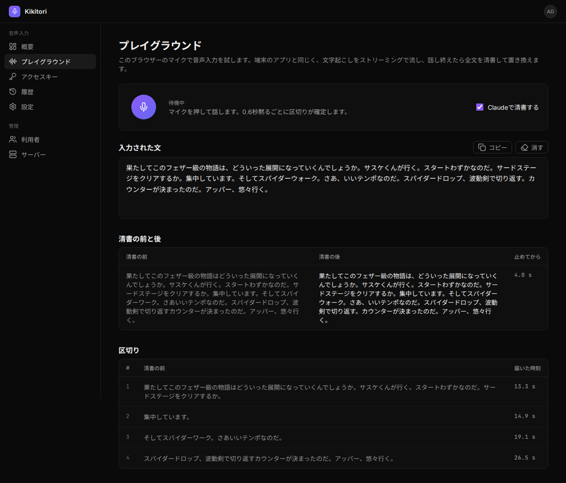
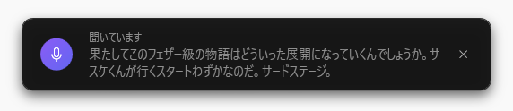
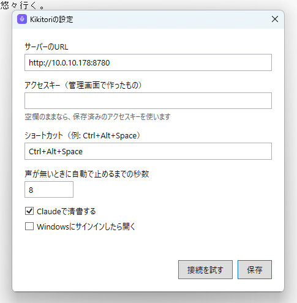
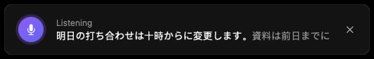
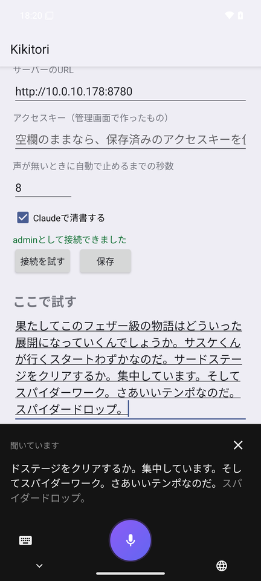

# Kikitori

話した言葉をストリーミングで文字起こしして入力欄へ流し、話し終えたら全文をClaudeで清書して置き換える音声入力です。

- 文字起こし: GPUの計算機で[Qwen3-ASR](https://github.com/QwenLM/Qwen3-ASR)（1.7B、vLLM）を動かします。話している途中の結果を0.5秒ごとに出し直し、0.6秒の無音で区切りを確定します。
- 清書: 話し終えたら全文を1回で、Claude（既定はClaude Sonnet 5.5）で言い淀みを消し句読点を整えた文にします。後ろの文まで見て、同じ読みの言葉などの誤認識も直します。
- 入力: Windowsは常駐のアプリが画面の下の小窓に文字起こしを流し、話し終えたら清書した全文を`SendInput`で前面のアプリへ打ち込みます。MacもメニューバーのアプリでWindowsと同じように動きます（キー入力はCGEvent）。Androidは音声入力だけのキーボードで、Gboardなどから切り替えて話すと文字起こしが未確定の文字で流れ、終わると清書した全文で確定して元のキーボードへ戻ります。
- 管理画面: アクセスキー・履歴・清書に使う言葉・利用者・清書のモデルとClaudeのAPIキーを管理します。ブラウザーのマイクで試せるプレイグラウンドもあります。



## 構成

| 置き場所 | 中身 |
|---|---|
| `asr-worker/` | 文字起こしの常駐プロセス（Python、Qwen3-ASR・Silero VAD）。GPUの計算機で動かす内部の口 |
| `apps/server/` | APIサーバー（Node.js 24、Hono、SQLite）。端末の音声を文字起こしへ流し、清書して返す。管理画面も出す |
| `apps/web/` | 管理画面（React、Vite、Tailwind CSS） |
| `packages/protocol/` | APIサーバーと端末・管理画面の要求と応答の形（zod） |
| `clients/windows/` | Windowsの常駐アプリ（.NET 10、WPF） |
| `clients/macos/` | Macのメニューバーのアプリ（Swift、AppKit・SwiftUI、macOS 14以上） |
| `clients/android/` | Androidの音声入力のキーボード（Kotlin、API 28以上） |
| `deploy/gpu3080/` | GPUの計算機に文字起こしとAPIサーバーを置くDocker Compose |
| `docs/` | 音声入力のWebSocketの手順（`dictation-protocol.md`）、文字起こしの常駐プロセスの手順（`asr-worker-protocol.md`） |

## サーバーを動かす

NVIDIAのGPU（12GB以上）とNVIDIA Container Toolkitが要ります。

```sh
# モデルの重みを置く（初回だけ）
mkdir -p ~/models/hf
docker run --rm -v ~/models/hf:/hf -e HF_HOME=/hf --entrypoint huggingface-cli \
  qwenllm/qwen3-asr:latest download Qwen/Qwen3-ASR-1.7B

# 鍵を置く（管理者の最初のパスワードと、清書に使うClaudeのAPIキー）
mkdir -p ~/.config/kikitori ~/.local/share/kikitori
chmod 700 ~/.config/kikitori
printf '%s\n' '<管理者のパスワード>' > ~/.config/kikitori/admin-password
printf '%s\n' '<ClaudeのAPIキー>' > ~/.config/kikitori/anthropic-api-key
chmod 600 ~/.config/kikitori/*

# 起動する（compose.yaml の ports の 10.0.10.178 は、サーバーのアドレスに合わせて変えます）
docker compose -f deploy/gpu3080/compose.yaml up -d --build
```

`http://<サーバー>:8780/`を開き、ユーザー名`admin`と上のパスワードでログインします。

ClaudeのAPIキーは、管理画面の「サーバー」でも入れられます。画面で入れたキーは、Anthropicに使えるキーかを確かめてからサーバーのデータベース（`~/.local/share/kikitori/kikitori.db`）に保存し、ファイルのキーより先に使います。どちらにもキーが無いときは、清書せずに文字起こしの結果をそのまま返します。

ブラウザーはHTTPSのページでしかマイクを使わせないので、プレイグラウンドは`https://<サーバー>:8443/playground`で開きます（`deploy/gpu3080/Caddyfile`。証明書はCaddyの内部のCAが出すので、初回はブラウザーが警告を出します。CAの証明書`~/.local/share/kikitori/caddy/caddy/pki/authorities/local/root.crt`をPCに入れると警告は出ません）。

## 端末をつなぐ

[最新のリリース](https://github.com/aida0710/kikitori/releases/latest)から、端末ごとのファイルを取ってきます。どれも、管理画面の「アクセスキー」で作ったキーと、サーバーのURLを入れて使います（キーは作った直後に一度だけ表示します）。

| 端末 | ファイル | 話し始めるには |
|---|---|---|
| Windows 10・11（64ビット） | `Kikitori-windows-x64.zip` | **Ctrl+Alt+Space** |
| Mac（macOS 14以上、Apple SiliconとIntel） | `Kikitori-macos.zip` | **Shift+Option+Space** |
| Android 9以上 | `Kikitori-android.apk` | キーボードの切り替えでKikitoriを選ぶ |

### Windows

1. `Kikitori-windows-x64.zip`を展開し、`Kikitori.exe`を好きな場所（例: `%LOCALAPPDATA%\Kikitori`）に置いて開きます。署名していないので、初回は「WindowsによってPCが保護されました」と出ます。「詳細情報」→「実行」を押します。
2. 設定画面にサーバーのURLとアクセスキーを入れ、「接続を試す」→「保存」を押します。「Windowsにサインインしたら開く」を入れておくと、次からは自動で常駐します。
3. 文字を入れたい欄を選んでから**Ctrl+Alt+Space**で話し始めます。話している間は画面の下の小窓に文字起こしが流れ、もう一度押すか8秒黙ると止まり、清書した全文を入力欄へ打ち込みます。
4. 設定を変えるときは、タスクトレイのアイコンを右クリックして「設定」を選ぶか、`Kikitori.exe`をもう一度開きます。





### Mac

1. `Kikitori-macos.zip`を展開し、`Kikitori.app`を「アプリケーション」に置きます。
2. 署名していないので、初回はそのままでは開けません。ターミナルで`xattr -dr com.apple.quarantine /Applications/Kikitori.app`を実行してから開くか、開こうとしたあとシステム設定の「プライバシーとセキュリティ」で「このまま開く」を押します。
3. メニューバーにマイクの印が出て、設定画面が開きます。サーバーのURLとアクセスキーを入れて「接続を試す」→「保存」を押します。
4. 設定画面の「アクセシビリティ」で「システム設定を開く」を押し、Kikitoriをオンにします（文字を打ち込むために要ります）。初めて話すときはマイクの許可も求められます。
5. 文字を入れたい欄を選んでから**Shift+Option+Space**で話し始めます。ログインのときに開くには、システム設定の「一般」→「ログイン項目」にKikitoriを足します。

Mac版を新しいバージョンに入れ替えると、アクセシビリティの許可をやり直す必要があります（署名が毎回変わるため）。



### Android

1. `Kikitori-android.apk`をスマホで開いて入れます（初回は「提供元不明のアプリ」の許可を求められます）。試験版（`Kikitori-android-debug.apk`）を入れていたときは、先にそれを消してください（署名が違うので上書きできません）。
2. Kikitoriのアプリを開き、「マイクを許可する」と「Kikitoriのキーボードをオンにする」を押します。サーバーのURLとアクセスキーを入れて「接続を試す」→「保存」を押します。アプリの下の「ここで試す」で試せます。
3. ふだんのキーボード（Gboardなど）で入力しているときに、キーボードの切り替えでKikitoriを選ぶと、すぐに聞き始めます。話している間は文字起こしが未確定の文字で流れ、マイクを押すか8秒黙ると、清書した全文で確定して元のキーボードへ戻ります。



## 開発

```sh
npm install
npm test               # APIサーバーの試験（vitest）
npm run typecheck
npm run dev:server     # APIサーバー（KIKITORI_ASR_URL で文字起こしの場所を指す）
npm run dev:web        # 管理画面（/api と /v1 を KIKITORI_API_SERVER へ中継）
```

- Windowsのアプリ: `clients/windows`で`dotnet publish -c Release`。Linuxの`mcr.microsoft.com/dotnet/sdk:10.0`でも組み立てられます。
- Macのアプリ: macOSで`clients/macos/tools/build-app.sh <版>`（GitHub Actionsの`.github/workflows/macos.yml`も同じ）。共通の部品（`KikitoriCore`）の試験は`swift test`で、Linuxでも動きます。
- Androidのアプリ: `clients/android/tools/android-sdk.Dockerfile`からイメージ`kikitori-android-sdk:37`を作り、`clients/android/tools/build-apk.sh`。

## ライセンス

[Apache License 2.0](LICENSE)です。
